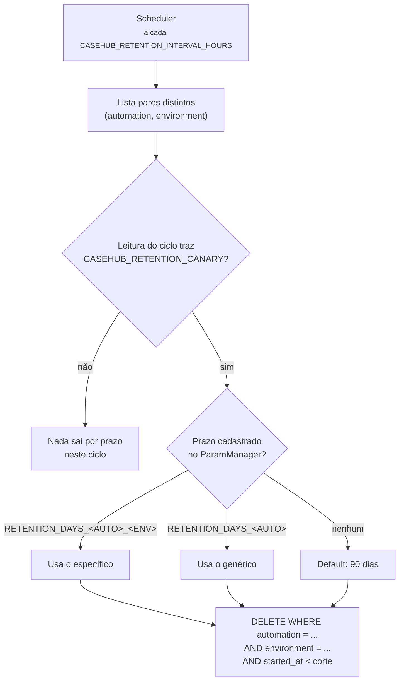

# Retenção

Um scheduler roda dentro do próprio processo da API e expurga casos
vencidos e, desde a API 0.8.0, anexos de caso. Ele sobe e desce junto com a aplicação — não há worker
separado.

## Onde o prazo é configurado

No **ParamManager**, sob o namespace do próprio fast-casehub
(`CASEHUB_RETENTION_PARAM_MANAGER_APP_NAME`, default `casehub`) — não
no namespace de cada automação consumidora.

Precedência, e a primeira que existir vence:

1. `RETENTION_DAYS_<AUTOMATION>_<ENVIRONMENT>`
2. `RETENTION_DAYS_<AUTOMATION>`
3. Default de **90 dias**

O nome da automação é sanitizado para a convenção
`MAIUSCULO_COM_UNDERSCORE`: qualquer caractere fora de `[A-Z0-9_]` vira
`_`.

| `automation` | Parâmetro genérico | Por ambiente |
|---|---|---|
| `minha-automacao` | `RETENTION_DAYS_MINHA_AUTOMACAO` | `RETENTION_DAYS_MINHA_AUTOMACAO_DEV` |

## O expurgo é sempre escopado por ambiente

!!! danger "Por que isso importa"
    Mesmo quando **só** o prazo genérico está cadastrado, o `DELETE`
    filtra por `environment`.

    Sem esse escopo, um prazo curto configurado para limpar `dev`
    durante um teste apagaria também os casos de `prod` da mesma
    automação — silenciosamente, no ciclo seguinte do scheduler, com até
    24 horas de atraso entre a configuração e o dano.

## Sem a sentinela, nada sai por prazo

Desde a API 0.8.0, cada ciclo lê o namespace do serviço no ParamManager
**uma vez** e resolve dessa mesma leitura todos os prazos do ciclo, de
casos e de anexos. O expurgo por prazo só roda se essa leitura trouxer o
parâmetro-sentinela `CASEHUB_RETENTION_CANARY` com valor não vazio.

Sem ele — ParamManager fora do ar e sem cópia local, cliente não
configurado ou parâmetro não cadastrado — o ciclo **não remove nenhum
caso nem anexo por prazo**, registra um aviso e soma 1 na métrica
`casehub.retention.skipped`.

!!! danger "Por que a sentinela existe"
    A biblioteca do ParamManager devolve "nada" tanto para parâmetro não
    cadastrado quanto para ParamManager fora do ar. Até a 0.7.x, os dois
    caíam no default de 90 dias: com o ParamManager fora, quem tinha
    cadastrado um prazo **maior** perdia casos. A sentinela distingue uma
    leitura de verdade de uma leitura vazia.

!!! warning "Cadastre a sentinela antes de atualizar para a 0.8.0"
    Um ambiente com retenção ligada e sem `CASEHUB_RETENTION_CANARY` para
    de expurgar por prazo no primeiro ciclo — de propósito. Valor
    sugerido: `ok`.

Com o ParamManager fora do ar mas com a cópia local de uma leitura
anterior, a biblioteca devolve essa cópia inteira: se ela tem a
sentinela, os prazos dela valem.

## Falha não derruba o ciclo

Se o expurgo de um par `(automação, ambiente)` falhar — Postgres
instável, por exemplo —, o erro é logado e o ciclo **segue para o
próximo**. Mesmo espírito do "erro por item não derruba o lote".

## Anexos de caso

O mesmo ciclo, logo depois dos casos, cuida dos anexos (ver
[Endpoints](endpoints.md#anexos-de-caso)).

**Prazo próprio, nunca herdado do caso.** Mesma precedência e mesma
sanitização do nome, com outro prefixo:

1. `ATTACHMENT_RETENTION_DAYS_<AUTOMATION>_<ENVIRONMENT>`
2. `ATTACHMENT_RETENTION_DAYS_<AUTOMATION>`
3. Padrão do serviço: **15 dias**

| `automation` | Parâmetro genérico | Por ambiente |
|---|---|---|
| `minha-automacao` | `ATTACHMENT_RETENTION_DAYS_MINHA_AUTOMACAO` | `ATTACHMENT_RETENTION_DAYS_MINHA_AUTOMACAO_DEV` |

- O valor precisa ser inteiro **maior ou igual a 1**. Inválido no
  parâmetro mais específico usa o padrão, com aviso, e não cai no
  genérico.
- O prazo conta de quando o conteúdo **vigente** foi gravado, não do
  `started_at` do caso. Substituir o conteúdo reinicia a contagem;
  reenviar o mesmo conteúdo, não.
- O expurgo é sempre escopado por automação **e** ambiente, como o de
  casos.

**O anexo nunca sobrevive ao caso.** No mesmo ciclo, sai todo anexo cujo
caso não existe mais, ou foi importado de novo depois do anexo (a chave
foi expurgada e reimportada: é outro caso). Isso vale qualquer que seja o
prazo do anexo e **não depende da sentinela**, porque não depende de
prazo. Um prazo de anexo maior que o do caso gera um aviso: o excedente
nunca é usado.

**Remoção garantida no storage.** O anexo removido some para a automação
na hora; o conteúdo sai do storage logo depois, ou, com o storage fora do
ar, num ciclo seguinte, até dar certo. Gravações interrompidas (o
processo caiu no meio do envio) também são limpas.

## O log de entregas tem prazo próprio

O expurgo descrito aqui cobre **casos**. O log de entregas dos webhooks
tem um prazo separado, `CASEHUB_WEBHOOK_DELIVERY_RETENTION_DAYS` (default
30 dias), e não depende do ParamManager. Ver
[Webhooks](webhooks.md#quando-falha).

!!! note "Um caso expurgado no meio de uma fila de entrega vira `abandoned`"
    Não há o que entregar, e insistir seria retry contra uma linha que
    não existe mais. O desfecho aparece no log de entregas e conta na
    métrica `casehub.webhook.delivered`.

## Desligando

`CASEHUB_RETENTION_ENABLED=false` — nenhum scheduler é criado e nenhum
ParamManager é instanciado. Desliga os dois expurgos, de casos e de
anexos.

É o default em ambientes sem ParamManager acessível: a suíte de testes,
o CI e o profile `uat` do compose.

## Observabilidade

A cada execução, a métrica `casehub.retention.deleted` é incrementada
com os labels `automation` e `environment`.

| Métrica | Tipo | Labels | O que diz |
|---|---|---|---|
| `casehub.retention.skipped` | contador | `reason` (`param_source_unconfigured`, `canary_missing`) | Ciclo que pulou o expurgo por prazo. **Alerte em qualquer valor acima de zero.** |
| `casehub.attachment.purged` | contador | `automation`, `environment`, `reason` (`expired`, `case_gone`, `replaced`, `deleted`, `stale_pending`) | Anexos removidos do storage. |
| `casehub.attachment.store_errors` | contador | `operation` (`put`, `get`, `delete`, `integrity`) | Falhas do storage de anexos. |
| `casehub.attachment.backlog` | medidor | `state` (`purging`, `pending`) | O que segue aguardando remoção ao fim de cada ciclo. Crescendo ciclo após ciclo: storage fora ou credencial recusada. |

!!! note "O label `environment` é novo"
    Ele foi adicionado quando o expurgo passou a ser escopado por
    ambiente. Consultas filtrando só por `automation` continuam
    funcionando, mas a série passou a ser dividida por ambiente — um
    painel que mostrava uma linha por automação agora mostra uma por
    automação × ambiente.
