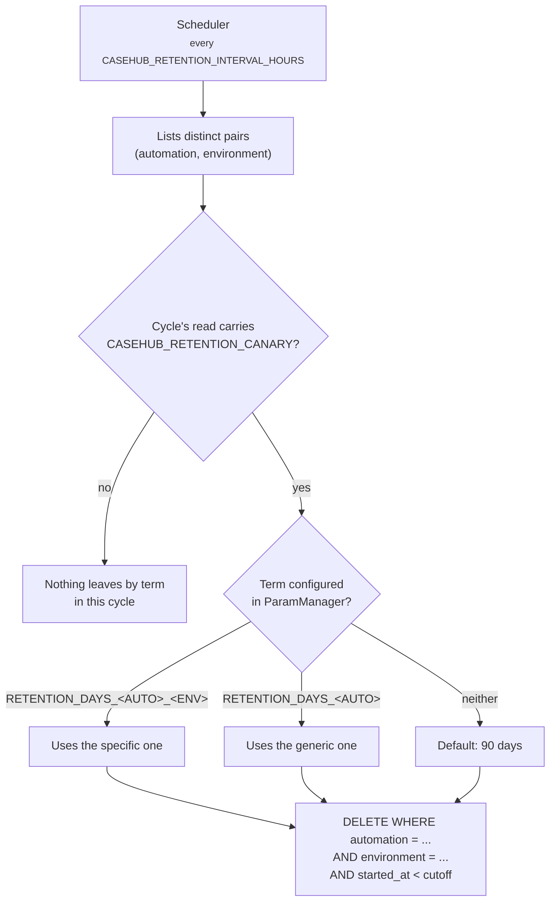

# Retention

A scheduler runs inside the API process itself and purges expired cases
and, since API 0.8.0, case attachments. It
comes up and goes down with the application — there is no separate worker.

## Where the term is configured

In **ParamManager**, under fast-casehub's own namespace
(`CASEHUB_RETENTION_PARAM_MANAGER_APP_NAME`, default `casehub`) — not under
the namespace of each consuming automation.

Precedence, and the first one that exists wins:

1. `RETENTION_DAYS_<AUTOMATION>_<ENVIRONMENT>`
2. `RETENTION_DAYS_<AUTOMATION>`
3. A default of **90 days**

The automation name is sanitized to the `UPPERCASE_WITH_UNDERSCORE`
convention: any character outside `[A-Z0-9_]` becomes `_`.

| `automation` | Generic parameter | Per environment |
|---|---|---|
| `minha-automacao` | `RETENTION_DAYS_MINHA_AUTOMACAO` | `RETENTION_DAYS_MINHA_AUTOMACAO_DEV` |

## The purge is always scoped by environment

!!! danger "Why this matters"
    Even when **only** the generic term is configured, the `DELETE` filters
    by `environment`.

    Without that scope, a short term set up to clean `dev` during a test
    would also wipe the `prod` cases of the same automation — silently, on
    the scheduler's next cycle, with up to 24 hours between the
    configuration and the damage.

## Without the sentinel, nothing leaves by term

Since API 0.8.0, each cycle reads the service's ParamManager namespace
**once** and resolves every term of the cycle, for cases and for
attachments, from that same read. Purging by term only runs if that read
carries the sentinel parameter `CASEHUB_RETENTION_CANARY` with a non-empty
value.

Without it — ParamManager down and no local copy, no client configured, or
the parameter not registered — the cycle **removes no case and no
attachment by term**, logs a warning and adds 1 to the
`casehub.retention.skipped` metric.

!!! danger "Why the sentinel exists"
    The ParamManager library returns "nothing" both for a parameter that
    was never registered and for a ParamManager that is down. Up to 0.7.x,
    both fell back to the 90-day default: with ParamManager down, whoever
    had configured a **longer** term lost cases. The sentinel tells a real
    read from an empty one.

!!! warning "Register the sentinel before upgrading to 0.8.0"
    An environment with retention on and no `CASEHUB_RETENTION_CANARY`
    stops purging by term on the first cycle — on purpose. Suggested
    value: `ok`.

With ParamManager down but holding the local copy of an earlier read, the
library returns that whole copy: if it carries the sentinel, its terms
apply.

## A failure does not bring the cycle down

If purging one `(automation, environment)` pair fails — an unstable
Postgres, for example — the error is logged and the cycle **moves on to
the next**. Same spirit as "a per-item error does not bring the batch
down".

## Case attachments

The same cycle, right after cases, takes care of attachments (see
[Endpoints](endpoints.md#case-attachments)).

**Its own term, never inherited from the case.** Same precedence and same
name sanitization, with another prefix:

1. `ATTACHMENT_RETENTION_DAYS_<AUTOMATION>_<ENVIRONMENT>`
2. `ATTACHMENT_RETENTION_DAYS_<AUTOMATION>`
3. Service default: **15 days**

| `automation` | Generic parameter | Per environment |
|---|---|---|
| `minha-automacao` | `ATTACHMENT_RETENTION_DAYS_MINHA_AUTOMACAO` | `ATTACHMENT_RETENTION_DAYS_MINHA_AUTOMACAO_DEV` |

- The value must be an integer **greater than or equal to 1**. An invalid
  value in the most specific parameter uses the default, with a warning,
  and does not fall back to the generic one.
- The term counts from when the **current** content was stored, not from
  the case's `started_at`. Replacing the content restarts the count;
  sending the same content again does not.
- The purge is always scoped by automation **and** environment, like the
  case purge.

**An attachment never outlives its case.** In the same cycle, every
attachment whose case no longer exists, or was imported again after the
attachment (the key was purged and re-imported: it is another case), is
removed. This holds whatever the attachment's term and **does not depend on
the sentinel**, since it does not depend on a term. An attachment term
longer than the case's raises a warning: the excess is never used.

**Guaranteed removal from storage.** A removed attachment disappears for
the automation right away; the content leaves the storage shortly after
or, with the storage down, on a later cycle, until it succeeds.
Interrupted uploads (the process died mid-upload) are cleaned up too.

## The delivery log has its own deadline

The purge described here covers **cases**. The webhook delivery log has a
separate deadline, `CASEHUB_WEBHOOK_DELIVERY_RETENTION_DAYS` (default 30
days), and does not depend on ParamManager. See
[Webhooks](webhooks.md#when-it-fails).

!!! note "A case purged mid-queue turns the delivery into `abandoned`"
    There is nothing to deliver, and insisting would retry against a row
    that no longer exists. The outcome shows up in the delivery log and
    counts towards the `casehub.webhook.delivered` metric.

## Turning it off

`CASEHUB_RETENTION_ENABLED=false` — no scheduler is created and no
ParamManager is instantiated. It turns off both purges, cases and
attachments.

It is the default in environments with no reachable ParamManager: the test
suite, CI, and the compose `uat` profile.

## Observability

On every run, the `casehub.retention.deleted` metric is incremented with the
`automation` and `environment` labels.

| Metric | Type | Labels | What it says |
|---|---|---|---|
| `casehub.retention.skipped` | counter | `reason` (`param_source_unconfigured`, `canary_missing`) | A cycle that skipped purging by term. **Alert on any value above zero.** |
| `casehub.attachment.purged` | counter | `automation`, `environment`, `reason` (`expired`, `case_gone`, `replaced`, `deleted`, `stale_pending`) | Attachments removed from storage. |
| `casehub.attachment.store_errors` | counter | `operation` (`put`, `get`, `delete`, `integrity`) | Attachment storage failures. |
| `casehub.attachment.backlog` | gauge | `state` (`purging`, `pending`) | What is still awaiting removal at the end of each cycle. Growing cycle after cycle: storage down or credential refused. |

!!! note "The `environment` label is new"
    It was added when the purge became scoped by environment. Queries
    filtering only by `automation` still work, but the series is now split by
    environment — a dashboard that showed one line per automation now shows
    one per automation × environment.
