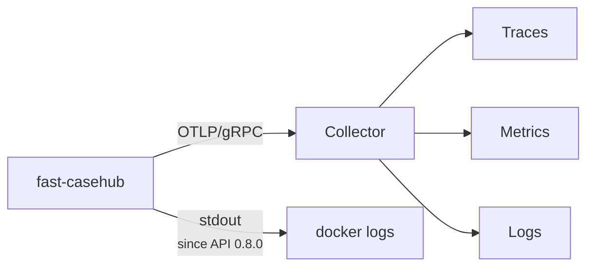

# Observability

Traces, metrics and logs leave over **OTLP/gRPC** to a collector. The
configuration uses the standard OpenTelemetry specification variables, read
by the SDK itself — there is no configuration of our own in code.



| Variable | For what |
|---|---|
| `OTEL_EXPORTER_OTLP_ENDPOINT` | Collector address. |
| `OTEL_SERVICE_NAME` | Service name in traces. |
| `OTEL_RESOURCE_ATTRIBUTES` | E.g. `deployment.environment=prod`. |
| `OTEL_SDK_DISABLED` | `true` turns everything off — no exporter is created. |
| `OTEL_SEMCONV_STABILITY_OPT_IN` | Convention for the HTTP names. Without it, the service assumes `http` (the stable one); empty goes back to the old one, `http/dup` emits both. |
| `CASEHUB_LOG_CONSOLE` | `true` (the default) also writes the logs to the process's stdout. |

`/health` and `/ready` are excluded from instrumentation: liveness probes
hit every few seconds and would fill the traces with noise carrying no
information.

## Metrics

Automatic instrumentation emits the first two; the `casehub.*` ones are
written by the service. In Prometheus, dots become `_` and counters get
the `_total` suffix — `casehub.api.errors` becomes
`casehub_api_errors_total`.

| Metric | Type | Labels | What it counts |
|---|---|---|---|
| `http.server.request.duration` | histogram | `http.route`, `http.request.method`, `http.response.status_code` | Latency per request, in seconds. The `_count` is what answers "how many requests today/yesterday/this week". |
| `http.server.active_requests` | gauge | route, method | Requests in flight. The average answers "how many clients at once". |
| `casehub.up` | gauge | — | Heartbeat: `1` while the process is up. |
| `casehub.api.errors` | counter | `http.route`, `http.response.status_code`, `error.code`, `casehub.automation` | Error responses (4xx and 5xx), on any route. Since API 0.8.0. |
| `casehub.auth.failures` | counter | `casehub.auth.stage`, `casehub.auth.reason` | Refused credentials, by stage and reason. Since API 0.8.0. See [When something is refused](#when-something-is-refused). |
| `casehub.retention.deleted` | counter | `automation`, `environment` | Cases purged per job run. |
| `casehub.retention.skipped` | counter | `reason` (`param_source_unconfigured`, `canary_missing`) | Cycles that did **not** purge by term, for lack of the sentinel. See [Retention](../api/retencao.md#without-the-sentinel-nothing-leaves-by-term). |
| `casehub.webhook.delivered` | counter | `automation`, `environment`, `outcome` | Webhook delivery **attempts**, by outcome. |

The attachment sweeper's metrics (`casehub.attachment.*`) are in
[Retention](../api/retencao.md#case-attachments).

!!! warning "The HTTP names changed in API 0.8.0"
    The service moved to the **stable** OpenTelemetry semantic
    convention. In Prometheus, `http_server_duration_milliseconds_*`
    became `http_server_request_duration_seconds_*`, and the labels
    `http_target`, `http_status_code` and `http_method` became
    `http_route`, `http_response_status_code` and `http_request_method`.
    The route comes without `/v1`: `/cases`, not `/v1/cases`. On the
    span, the caller's IP moved from `net.peer.ip` to `client.address`.

    To go back to the old convention without changing versions, set
    `OTEL_SEMCONV_STABILITY_OPT_IN=` (empty) and restart the service. See
    [What changed](../mudancas.md).

!!! warning "The counter is of attempts, and `outcome` has four values"
    `succeeded`, `failed`, `retrying` and `abandoned`. A delivery that
    fails three times and then arrives adds **three** `retrying` and one
    `succeeded` — summing every outcome gives attempts, not deliveries.

    `abandoned` is the delivery that did not go out because the rule
    stopped matching, the case was purged first, or the subscription was
    removed mid-queue. A panel filtering only success and failure
    under-reports precisely the outcome that most deserves an alert. See
    [Webhooks](../api/webhooks.md#when-it-fails).

!!! tip "`casehub.up` is read by absence, not by value"
    It is `1` whenever it exists — never `0`. The signal that the service is
    down is the **missing data** in the series, not a drop in value. An
    alert written as `casehub.up == 0` never fires; the right thing is to
    alert on missing samples in the window.

!!! note "The HTTP metrics do not count the probes"
    `/health` and `/ready` are outside instrumentation, as said above. That
    is what you want — but it means `http.server.request.duration` measures
    real traffic and does not match the volume the load balancer sees.

!!! note "The `environment` label was added"
    It came in when the purge became scoped by environment. Queries
    filtering only by `automation` still work — but the series is now split
    by environment, so a dashboard that showed one line per automation now
    shows one per automation × environment.

## Access logs

The `/v1/cases*` and `/v1/auth/*` routes emit a structured `INFO` log per
**successful** request, carrying the caller's IP, the OIDC identity
(`sub`/`azp` claims) and details of the operation — on `GET /v1/cases`,
for instance, how many items matched the filter and how many came in the
page.

Before that, no business route logged anything on success: only traces
and metrics answered "who/when/how many", and anyone looking at Loki
alone had no way to know a query had happened.

!!! danger "What these logs deliberately do not carry"
    `source_record` and the **values** of `filter=` are left out. Only the
    keys used in the filter appear, never the content — it is business
    payload, potentially with sensitive data.

    On webhook registration, the partner URL is logged as scheme and host
    only (`https://hooks.example.com/<redacted>`). In a good share of
    real receivers — Slack, Teams, Zapier, any callback with a token in
    the path — **the whole URL is the publishing credential**, and this
    log goes out over OTLP. Whoever needs the exact URL has the
    `webhook_id` on the same line and the subscription lookup.

## When something is refused

Since API 0.8.0, **every error response leaves a trail**, on any route:
one log per response on the `casehub_api.errors` logger, the
`casehub.api.errors` metric and the `casehub.error.code` attribute on
the span. Before, a 403 or most 4xx produced no log at all.

| Status | Log level |
|---|---|
| 5xx | `ERROR`, with the stack trace on a 500 |
| 401 and 403 | `WARNING` (`Credencial recusada`) |
| other 4xx | `INFO` |

The record carries the error code, the status, the method, the
parameterized route, the IP and, with a valid token, the identity and
the automation. A validation 400 says **where** the error is and of
**what kind**, never the value received.

### Why the credential was refused

Every 401 and 403 — and the 503 for the identity provider being down —
comes out with the **stage** and the **reason**, from a closed set:

| Stage (`casehub.auth.stage`) | Reasons (`casehub.auth.reason`) |
|---|---|
| `token_issue` — the `POST /v1/auth/token` | `idp_rejected`, `idp_unavailable`, `idp_invalid_response`, `oidc_not_configured` |
| `token_validation` — the Bearer on each call | `missing_credentials`, `token_expired`, `token_not_yet_valid`, `invalid_signature`, `invalid_issuer`, `invalid_audience`, `invalid_algorithm`, `missing_required_claim`, `malformed_token`, `jwks_unavailable`, `unknown_key`, `invalid_token` |
| `authorization` — valid token, wrong scope | `missing_automation_claim`, `automation_mismatch` |

Depending on the stage, the log carries what helps close the diagnosis:
the client the token **claims** to be (unverified) and, when expired,
how many seconds ago it expired; on a provider refusal, the `client_id`
given and the OAuth2 code (`invalid_client`, `unauthorized_client`); on
a 403, the token's automation and the one requested.

```promql
sum by (casehub_auth_stage, casehub_auth_reason) (
  increase(casehub_auth_failures_total[1h])
)
```

!!! danger "The reason stays on the inside"
    No response changes: the 401 body stays generic. Telling the caller
    **why** the credential failed would help whoever is guessing one.
    Tokens, `client_secret` and `refresh_token` appear in no record, and
    the metric label never carries the `client_id`.

## The purge has a trace too

Each purge cycle runs in the `retention_run` span, with the attachment
sweeper in the `attachment_sweep` child span, and ends with the
`retenção: ciclo concluído` log and the cycle's counts. The standalone
`casehub-retention` and `casehub-webhook` commands send traces, metrics
and logs to the collector with the same configuration as the service.

## What does not show up in traces

!!! danger "`source_record` is not captured, and that is on purpose"
    The HTTP instrumentation does not capture request bodies, and no span or
    log records the content of `source_record`. Since it may carry sensitive
    data, capturing it would take that data to the observability backend — a
    place with entirely different access and retention policies from the
    database's.

    The product decision about storing sensitive data covers **storage**,
    not observability.

!!! warning "`CASEHUB_DB_ECHO=true` breaks this"
    Turning SQLAlchemy's echo on sends the SQL — with its parameters,
    `source_record` included — to stdout. It is useful in local debugging
    and **must not be turned on in a shared environment**.

In the same way, the 500 error response never carries the detail of the
failure: the exception goes only to the correlated log. See
[Errors](../api/erros.md#internal-error).

## Correlation

Logs come out correlated by `trace_id`/`span_id`, so an error seen in the
log leads to the request's full trace.

Since API 0.8.0 the logs also go to the process's **stdout** — and so to
`docker logs` —, with `trace_id` and `span_id` on each line. Before,
they only left through OTLP and were lost with the collector down.
`CASEHUB_LOG_CONSOLE=false` turns that path off.

!!! warning "The `otel*` fields left the logs in API 0.8.0"
    `otelTraceID`, `otelSpanID`, `otelServiceName` and `otelTraceSampled`
    were copies of `trace_id`, `span_id` and `service_name`, which still
    arrive. A query or dashboard filtering on the `otel*` ones has to
    switch to the native fields.

To correlate with Temporal, the case's `temporal_workflow_id` and
`temporal_run_id` fields tie the record to the execution that produced it.
They are optional and have no foreign key — they are for investigation, not
for referential integrity.

## What to watch

| Signal | Why it matters |
|---|---|
| Absence of `casehub.up` | The process is not reporting — the service is down, or telemetry is broken. |
| `/ready` answering 503 | The database went down; the service is up but unusable. |
| `casehub.auth.failures` climbing | An expired token, a badly provisioned client, or an automation trying someone else's scope — the `casehub.auth.reason` label says which. |
| Non-empty `errors[]` in batches | A failure **on the publisher's side** — it does not show up as an HTTP error. |
| The `aud` warning at startup | `aud` validation is not active in this environment. See the plan in [Authentication](../api/autenticacao.md#validating-aud). |
| `casehub.retention.deleted` off expectation | A badly configured term in ParamManager. |
| `casehub.retention.skipped` climbing | Purging by term stopped: the sentinel is missing, or ParamManager is unreachable with no local copy. Since API 0.8.0 this **no longer** falls back to a default term. |
| `casehub.webhook.delivered{outcome="failed"}` climbing | A partner endpoint is down. Consecutive failures disable the subscription on their own — see [Webhooks](../api/webhooks.md#when-it-fails). |

!!! danger "A batch with a rejected item produces no HTTP error"
    It is the most common blind spot: the 5xx dashboard stays clean while
    cases are discarded. If you only monitor HTTP status, you are not
    monitoring publication — instrument `errors[]` on the publisher's side.
