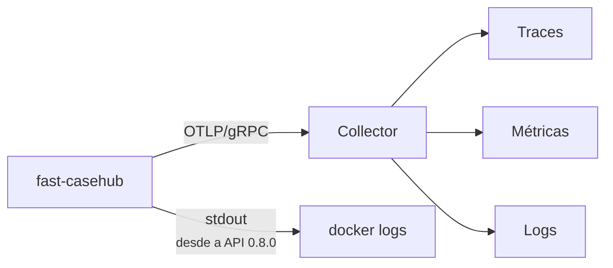

# Observabilidade

Traces, métricas e logs saem por **OTLP/gRPC** para um collector. A
configuração usa as variáveis padrão da especificação do OpenTelemetry,
lidas pelo próprio SDK — não há configuração própria em código.



| Variável | Para quê |
|---|---|
| `OTEL_EXPORTER_OTLP_ENDPOINT` | Endereço do collector. |
| `OTEL_SERVICE_NAME` | Nome do serviço nos traces. |
| `OTEL_RESOURCE_ATTRIBUTES` | Ex.: `deployment.environment=prod`. |
| `OTEL_SDK_DISABLED` | `true` desliga tudo — nenhum exporter é criado. |
| `OTEL_SEMCONV_STABILITY_OPT_IN` | Convenção dos nomes HTTP. Sem ela, o serviço assume `http` (a estável); vazia volta à antiga, `http/dup` emite as duas. |
| `CASEHUB_LOG_CONSOLE` | `true` (padrão) também escreve os logs no stdout do processo. |

`/health` e `/ready` são excluídos da instrumentação: probes de
liveness batem a cada poucos segundos e encheriam os traces de ruído
sem informação.

## Métricas

A instrumentação automática emite as duas primeiras; as `casehub.*` são
escritas pelo serviço. No Prometheus, os pontos viram `_` e os
contadores ganham o sufixo `_total` — `casehub.api.errors` vira
`casehub_api_errors_total`.

| Métrica | Tipo | Labels | O que conta |
|---|---|---|---|
| `http.server.request.duration` | histograma | `http.route`, `http.request.method`, `http.response.status_code` | Latência por requisição, em segundos. O `_count` é o que responde "quantas requisições hoje/ontem/semana". |
| `http.server.active_requests` | gauge | rota, método | Requisições em voo. A média responde "quantos clientes ao mesmo tempo". |
| `casehub.up` | gauge | — | Heartbeat: `1` enquanto o processo estiver de pé. |
| `casehub.api.errors` | contador | `http.route`, `http.response.status_code`, `error.code`, `casehub.automation` | Respostas de erro (4xx e 5xx), em qualquer rota. Desde a API 0.8.0. |
| `casehub.auth.failures` | contador | `casehub.auth.stage`, `casehub.auth.reason` | Credenciais recusadas, por etapa e motivo. Desde a API 0.8.0. Ver [Quando algo é recusado](#quando-algo-e-recusado). |
| `casehub.retention.deleted` | contador | `automation`, `environment` | Casos expurgados por execução do job. |
| `casehub.retention.skipped` | contador | `reason` (`param_source_unconfigured`, `canary_missing`) | Ciclos que **não** expurgaram por prazo, por falta da sentinela. Ver [Retenção](../api/retencao.md#sem-a-sentinela-nada-sai-por-prazo). |
| `casehub.webhook.delivered` | contador | `automation`, `environment`, `outcome` | **Tentativas** de entrega de webhook, por desfecho. |

As métricas do varredor de anexos (`casehub.attachment.*`) estão em
[Retenção](../api/retencao.md#anexos-de-caso).

!!! warning "Os nomes HTTP mudaram na API 0.8.0"
    O serviço passou à convenção semântica **estável** do
    OpenTelemetry. No Prometheus, `http_server_duration_milliseconds_*`
    virou `http_server_request_duration_seconds_*`, e os rótulos
    `http_target`, `http_status_code` e `http_method` viraram
    `http_route`, `http_response_status_code` e `http_request_method`.
    A rota sai sem o `/v1`: `/cases`, e não `/v1/cases`. No span, o IP
    de quem chamou foi de `net.peer.ip` para `client.address`.

    Para voltar à convenção antiga sem trocar de versão, defina
    `OTEL_SEMCONV_STABILITY_OPT_IN=` (vazio) e reinicie o serviço. Ver
    [O que mudou](../mudancas.md).

!!! warning "O contador é de tentativas, e `outcome` tem quatro valores"
    `succeeded`, `failed`, `retrying` e `abandoned`. Uma entrega que
    falha três vezes e depois chega soma **três** `retrying` e um
    `succeeded` — somar todos os desfechos dá tentativas, não entregas.

    `abandoned` é a entrega que não saiu porque a regra deixou de casar,
    o caso foi expurgado antes, ou a assinatura foi removida no meio da
    fila. Um painel que filtre só sucesso e falha sub-reporta justamente
    o desfecho que mais merece alerta. Ver
    [Webhooks](../api/webhooks.md#quando-falha).

!!! tip "`casehub.up` se lê pela ausência, não pelo valor"
    Ele vale `1` sempre que existe — nunca `0`. O sinal de serviço fora
    do ar é a **falta de dado** na série, não uma queda de valor. Um
    alerta escrito como `casehub.up == 0` nunca dispara; o correto é
    alertar sobre ausência de amostras na janela.

!!! note "As métricas HTTP não contam as probes"
    `/health` e `/ready` estão fora da instrumentação, como dito acima.
    Isso é o que se quer — mas significa que `http.server.request.duration`
    mede o tráfego real, e não bate com o volume que o balanceador vê.

!!! note "O label `environment` foi adicionado"
    Ele entrou quando o expurgo passou a ser escopado por ambiente.
    Consultas que filtram só por `automation` continuam funcionando —
    mas a série passou a ser dividida por ambiente, então um painel que
    mostrava uma linha por automação agora mostra uma por
    automação × ambiente.

## Logs de acesso

As rotas de `/v1/cases*` e `/v1/auth/*` emitem um log `INFO` estruturado
por requisição **bem-sucedida**, com o IP de quem chamou, a identidade
OIDC (claims `sub`/`azp`) e detalhes da operação — em `GET /v1/cases`,
por exemplo, quantos itens bateram o filtro e quantos vieram na página.

Antes, nenhuma rota de negócio logava nada em sucesso: só traces e
métricas respondiam "quem/quando/quantas", e quem olhasse apenas o Loki
não tinha como saber que uma consulta tinha acontecido.

!!! danger "O que esses logs deliberadamente não carregam"
    `source_record` e os **valores** de `filter=` ficam fora. Só as
    chaves usadas no filtro aparecem, nunca o conteúdo — é payload de
    negócio, potencialmente com dado sensível.

    No cadastro de webhook, a URL do parceiro é registrada só como
    esquema e host (`https://hooks.exemplo.com/<redigido>`). Em boa parte
    dos receptores reais — Slack, Teams, Zapier, qualquer callback com
    token no caminho — **a URL inteira é a credencial de publicação**, e
    esse log sai por OTLP. Quem precisar da URL exata tem o `webhook_id`
    na mesma linha e a consulta da assinatura.

## Quando algo é recusado

Desde a API 0.8.0, **toda resposta de erro deixa rastro**, em qualquer
rota: um log por resposta no logger `casehub_api.errors`, a métrica
`casehub.api.errors` e o atributo `casehub.error.code` no span. Antes,
um 403 ou a maior parte dos 4xx não geravam log nenhum.

| Status | Nível do log |
|---|---|
| 5xx | `ERROR`, com o stack trace no 500 |
| 401 e 403 | `WARNING` (`Credencial recusada`) |
| demais 4xx | `INFO` |

O registro traz o código do erro, o status, o método, a rota
parametrizada, o IP e, com token válido, a identidade e a automação. O
400 de validação diz **onde** está o erro e de **que tipo** ele é,
nunca o valor recebido.

### Por que a credencial foi recusada

Todo 401 e 403 — e o 503 do provedor de identidade fora do ar — sai com
a **etapa** e o **motivo**, de um conjunto fechado:

| Etapa (`casehub.auth.stage`) | Motivos (`casehub.auth.reason`) |
|---|---|
| `token_issue` — o `POST /v1/auth/token` | `idp_rejected`, `idp_unavailable`, `idp_invalid_response`, `oidc_not_configured` |
| `token_validation` — o Bearer de cada chamada | `missing_credentials`, `token_expired`, `token_not_yet_valid`, `invalid_signature`, `invalid_issuer`, `invalid_audience`, `invalid_algorithm`, `missing_required_claim`, `malformed_token`, `jwks_unavailable`, `unknown_key`, `invalid_token` |
| `authorization` — token válido, escopo errado | `missing_automation_claim`, `automation_mismatch` |

Conforme a etapa, o log traz o que ajuda a fechar o diagnóstico: o
client que o token **diz** ser (não verificado) e, no vencido, há
quantos segundos ele venceu; na recusa do provedor, o `client_id`
informado e o código OAuth2 (`invalid_client`, `unauthorized_client`);
no 403, a automação do token e a pedida.

```promql
sum by (casehub_auth_stage, casehub_auth_reason) (
  increase(casehub_auth_failures_total[1h])
)
```

!!! danger "O motivo fica do lado de dentro"
    Nenhuma resposta muda: o corpo do 401 continua genérico. Dizer a
    quem chama **por que** a credencial falhou ajudaria quem tenta
    adivinhar uma. Token, `client_secret` e `refresh_token` não aparecem
    em nenhum registro, e o rótulo da métrica nunca leva o `client_id`.

## O expurgo também tem trace

Cada ciclo do expurgo roda no span `retention_run`, com o varredor de
anexos no span filho `attachment_sweep`, e termina com o log
`retenção: ciclo concluído` e as contagens do ciclo. Os comandos
avulsos `casehub-retention` e `casehub-webhook` enviam traces, métricas
e logs ao collector com a mesma configuração do serviço.

## O que não aparece nos traces

!!! danger "`source_record` não é capturado, e isso é proposital"
    A instrumentação HTTP não captura corpo de requisição, e nenhum span
    ou log grava o conteúdo de `source_record`. Como ele pode carregar
    dado sensível, capturá-lo levaria esse dado para o backend de
    observabilidade — um lugar com política de acesso e retenção
    completamente diferentes das do banco.

    A decisão de produto sobre armazenar dado sensível cobre o
    **armazenamento**, não a observabilidade.

!!! warning "`CASEHUB_DB_ECHO=true` quebra isso"
    Ligar o echo do SQLAlchemy faz o SQL — com os parâmetros, incluindo
    o `source_record` — ir para o stdout. É útil em depuração local e
    **não deve ser ligado em ambiente compartilhado**.

Do mesmo modo, a resposta de erro 500 nunca carrega o detalhe da falha:
a exceção vai só para o log correlacionado. Ver
[Erros](../api/erros.md#erro-interno).

## Correlação

Logs saem correlacionados por `trace_id`/`span_id`, então um erro
observado no log leva ao trace completo da requisição.

Desde a API 0.8.0 os logs também saem no **stdout** do processo — e
portanto no `docker logs` —, com `trace_id` e `span_id` em cada linha.
Antes, eles só saíam pelo OTLP e se perdiam com o collector fora do ar.
`CASEHUB_LOG_CONSOLE=false` desliga esse caminho.

!!! warning "Os campos `otel*` saíram dos logs na API 0.8.0"
    `otelTraceID`, `otelSpanID`, `otelServiceName` e `otelTraceSampled`
    eram cópias de `trace_id`, `span_id` e `service_name`, que continuam
    chegando. Query ou painel que filtre pelos `otel*` precisa trocar
    para os nativos.

Para correlacionar com o Temporal, os campos `temporal_workflow_id` e
`temporal_run_id` do caso ligam o registro à execução que o produziu.
São opcionais e não têm chave estrangeira — servem para investigação,
não para integridade referencial.

## O que observar

| Sinal | Por que importa |
|---|---|
| Ausência de `casehub.up` | O processo não está reportando — serviço fora do ar, ou telemetria quebrada. |
| `/ready` respondendo 503 | O banco caiu; o serviço está de pé mas inutilizável. |
| `casehub.auth.failures` subindo | Token expirado, client mal provisionado ou automação tentando escopo alheio — o rótulo `casehub.auth.reason` diz qual. |
| `errors[]` não vazio nos lotes | Falha **do lado do publicador** — não aparece como erro HTTP. |
| Aviso de `aud` na subida | A validação de `aud` não está ativa neste ambiente. Ver o roteiro em [Autenticação](../api/autenticacao.md#validacao-de-aud). |
| `casehub.retention.deleted` fora do esperado | Prazo mal configurado no ParamManager. |
| `casehub.retention.skipped` subindo | O expurgo por prazo parou: falta a sentinela, ou o ParamManager está inacessível sem cópia local. Desde a API 0.8.0 isso **não** cai mais num prazo padrão. |
| `casehub.webhook.delivered{outcome="failed"}` subindo | Endpoint de parceiro fora do ar. Falhas seguidas desativam a assinatura sozinhas — ver [Webhooks](../api/webhooks.md#quando-falha). |

!!! danger "Lote com item recusado não gera erro HTTP"
    É o ponto cego mais comum: o painel de erros 5xx fica limpo enquanto
    casos são descartados. Se você monitora só status HTTP, não está
    monitorando a publicação — instrumente `errors[]` do lado do
    publicador.
